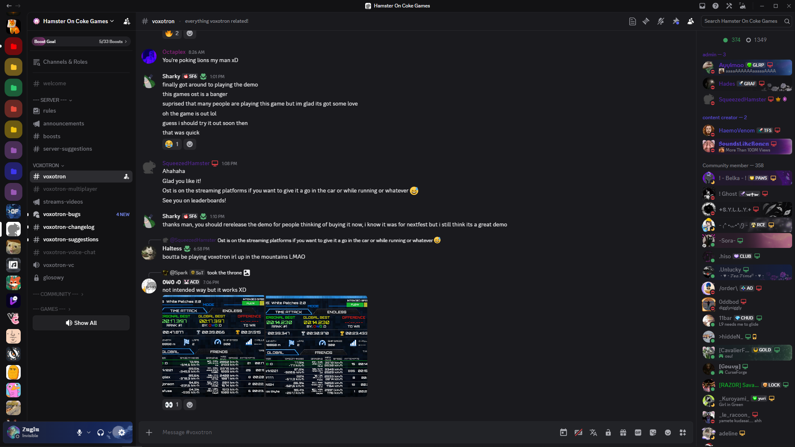

# NewerOldCordCustom

**A personal project to keep the classic Discord layout alive on the current client.**  
_It started as a fork of NewerOldCord, but by now it has been rebuilt almost from scratch: new structure, new fixes, and a lot less lag._

_Made to work with BetterFolders and PlainFolderIcon without breaking anything._

---

# Comparison



_Stock Discord, then NewerOldCordCustom._

---

## ❗ Disclaimer

I'm very much an **amateur** — not a CSS expert — and this is all built through trial, error, and lots of tweaking.

Discord renames its CSS classes every now and then. When that happens, parts of the theme will break until I update it. I fix it when I can, but I'm only doing this for myself and sharing it, so no promises.

---

## 🔦 What This Theme Does

- Keeps the **classic Discord layout**: the old title bar, the user panel under the channel list, square-ish corners.
- Restyles everything to look like the **2024 Discord UI**: colors, buttons, inputs, modals, emoji picker, polls, forums...
- **V5 is a performance rework.** The previous versions were the cause of some lag: rules that ran on every element of the page, and around 2,000 lines that never applied to anything. Those are gone.
- **Fullscreen streams are actually fullscreen.** The window bar no longer sits on top of the stream.
- Works with **BetterFolders** and **PlainFolderIcon** (Vencord).

> ⚠️ **Light Mode is not supported.**  
> This theme was built for dark mode (and tested on **Darker**) — it hasn't been styled for light mode.

---

## 🛠 Installation

You can use this theme with **BetterDiscord**, **Vencord**, or any modded client that supports custom CSS.

---

### ✅ BetterDiscord

1. [Download `NewerOldCord.css`](https://raw.githubusercontent.com/SoonBanned/NewerOldCordCustom/refs/heads/main/NewerOldCord.css)  
   (Right-click > "Save As", and name it `NewerOldCord.theme.css`, BetterDiscord only picks up `.theme.css` files)
2. Move it to your themes folder:  
   - **Windows**: `%appdata%/BetterDiscord/themes`  
   - **Linux**: `~/.config/BetterDiscord/themes`
3. Enable the theme in your BetterDiscord settings.

---

### ✅ Vencord

#### Online Method (recommended):
1. Go to `Settings > Vencord > Themes`
2. Click "Add Theme" and paste this URL:

```
https://raw.githubusercontent.com/SoonBanned/NewerOldCordCustom/refs/heads/main/src/v5/main_v5.css
```

#### Local Installation:
1. [Download `NewerOldCord.css`](https://raw.githubusercontent.com/SoonBanned/NewerOldCordCustom/refs/heads/main/NewerOldCord.css)
2. In Discord: `Settings > Vencord > Themes > Open Theme Folder`
3. Place the file in that folder and enable it.

The online method updates on its own, so you get fixes as soon as I push them.

---

### 🎛 Manual Import via CSS

You can also import it directly in your QuickCSS:

```css
@import url("https://raw.githubusercontent.com/SoonBanned/NewerOldCordCustom/refs/heads/main/src/v5/main_v5.css");
```

---

## 🧩 Tweaks

A few things you can change by pasting them in your QuickCSS:

```css
:root {
  /* height of the window bar while watching a stream in fullscreen
     0px = no bar at all (Esc still exits fullscreen) */
  --nol-fullscreen-bar-height: 16px;

  /* member list: put the server tag and the Vencord icons (platform, voice...)
     on a second line under the username, so they stop overlapping long names
     off by default, set it to 1 to turn it on */
  --nol-member-tags-newline: 1;
}
```

---

## 💬 Something Broke?

Most of the time it's Discord renaming its classes again. If something looks off, open an issue with a screenshot (and the page's HTML if you know how to grab it from the DevTools), it helps a lot.

---

## ❤️ Credits

- [**OldCord**](https://github.com/milbits/oldcord) by milbit — where all of this comes from.
- [**NewerOldCord**](https://github.com/FrCynda/NewerOldCord) by Cyn — the refresh this project started from.
